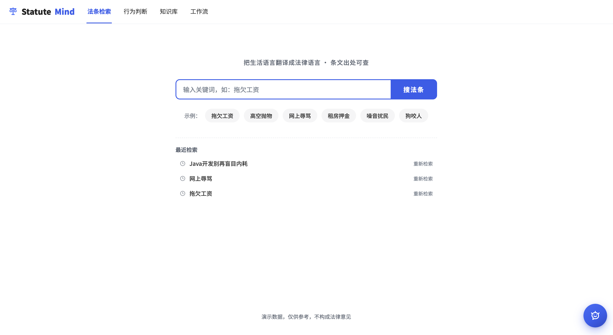
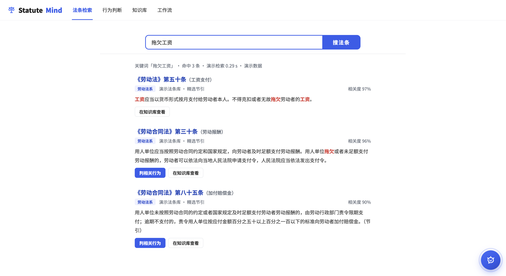
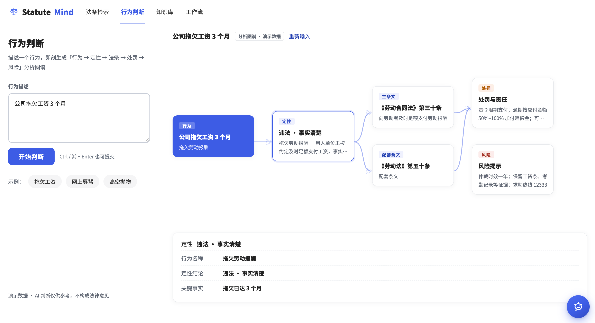
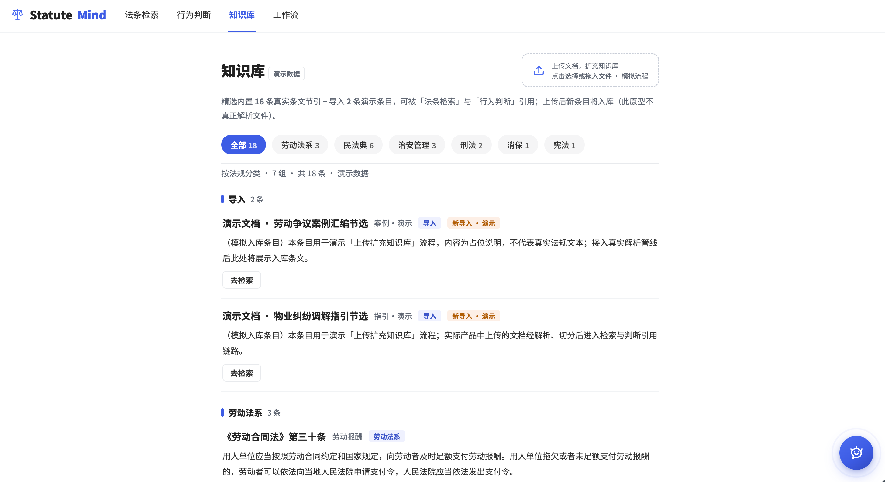
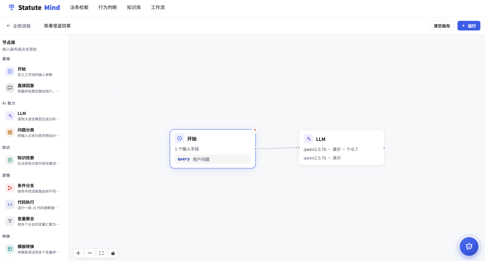

# statuteMind · 法规智能引擎

面向法律法规的智能检索与行为判断应用：输入关键词检索法条，或用一句话描述一个行为，即刻生成「行为 → 定性 → 法条 → 处罚 → 风险」分析图谱；另内置可视化工作流编排，可将检索与判断串成可运行的节点流程。

> 当前为原型演示阶段，全部数据为内置模拟数据，AI 判断仅供参考，不构成法律意见。

## 功能

### 法条检索（搜法条）

| 首页态 | 结果态 |
|---|---|
|  |  |

**搜索流程**

1. 首页态：居中展示品牌区、模式切换 Tab（搜法条 | 判行为）、620px 大搜索框（2px 品牌蓝描边，右侧同高蓝色「搜索一下」按钮）、示例关键词 chips 与最近检索记录
2. 提交后进入检索态：品牌大字与 chips 隐藏，搜索框收窄为 42px 高的吸顶窄条（左侧出现小 logo，点击返回首页态）；结果区先显示「正在检索…」文字与 0.7s 蓝色进度条，随后结果条目逐条错峰浮现
3. 结果列固定 720px 居中，保证长句摘要的最佳阅读行宽

**结果条目**，自上而下依次为：

- 法规标题（链接蓝，点击进入详情），标题前缀发布机关名（如「中华人民共和国劳动法」）
- 出处行：效力级别标签（法律 / 行政法规 / 部门规章）、发文机关、公布日期、相关度评分（等宽数字右对齐）
- 摘要：截取与关键词最相关的条文片段，命中关键词以红色加粗高亮
- 操作行：「判相关行为」（主按钮，携带本条法条跳转行为判断）、「在知识库查看」（跳转知识库并定位）、「去检索」（以法条编号为关键词回到检索）

**检索能力**

- 示例关键词一键检索（如「拖欠工资」「高空抛物」「个人信息保护」）
- 最近检索记录：展示最近数条历史，点击直接复查；支持清空
- 关键词为空或无命中时展示友好空态，引导使用示例关键词

### 行为判断（判行为）

**左右双面板布局**

- 左侧为行为描述输入区（400px）：标题与说明文案、多行行为描述输入框（可纵向拉伸）、「开始判断」按钮（支持 Ctrl / ⌘ + Enter 快捷提交）、示例行为 chips（公司拖欠工资 3 个月、网上辱骂他人、高空抛物等）、底部「演示数据 · AI 判断仅供参考」注脚
- 右侧为分析图谱展示区：未提交时显示引导空态；提交后生成图谱，顶部为结论标题、「分析图谱 · 演示数据」标识与「重新输入」按钮

**分析图谱**，四列节点图：

| 列 | 节点 | 内容 |
|---|---|---|
| 1 | 行为（根节点，蓝底白字） | 用户描述的原始行为 |
| 2 | 定性 | 违法定性结论与构成要件理由 |
| 3 | 主条文 / 关联条文 | 适用法条编号、条文要旨与处置要点 |
| 4 | 处罚 & 风险 | 处罚种类与幅度；衍生法律风险提示 |

- 节点间以带箭头的贝塞尔曲线连接，连线与箭头逐条错峰描线，节点卡按列错峰升起，直观呈现推理顺序
- 点击任一节点，右侧图谱下方展开该节点的结构化详情卡：类型标签、标题与要点键值行；法条节点附「在知识库查看」（跳转知识库并高亮定位）与「去检索」（以法条编号发起检索）操作
- 未收录的行为：右面板展示提示态并附示例行为 chips，引导用户从示例入手
- 窄屏（<960px）自动切换为上下堆叠布局，连线隐藏、节点纵向排列；窗口缩放后连线坐标自动重算

### 知识库

- **模拟上传**：虚线框上传按钮，提交后法规总数 +2 并触发顶栏徽标计数跳动
- **分类筛选**：分类 chips 携带条目计数（如「劳动 4」「治安 3」），选中态实心蓝底白字
- **分组展示**：法规按发布机关分组，组头带蓝色竖条；条目平铺展示全文（条文分条排版），便于通读
- **跨视图操作**：每条法规可「判相关行为」「去检索」；从行为判断或检索跳入时，目标条目以蓝底闪烁 1.2s 定位，并平滑滚动到位

### 工作流编排

- **流程管理**：`#/workflow` 首页以程序化 SVG 缩略图预览全部流程，支持新建、删除与按最近更新排序，点击卡片进入编排界面
- **类 Dify 画布**：左侧节点库按「基础 / AI 能力 / 知识 / 逻辑 / 转换」五组收纳节点，中间无限画布支持拖入节点、鼠标拖拽连线与缩放控件，顶部可命名流程、清空画布、一键运行
- **节点类型**：开始、直接回复、LLM、问题分类、知识检索、条件分支、代码执行、变量聚合、模板转换、HTTP 请求共 10 种，节点间以变量引用传递数据
- **运行追踪**：运行时填入开始节点字段，底部追踪面板逐节点展示执行状态与输入 / 输出 JSON（可展开），并流式预览最终回复；画布内容自动保存至 localStorage

### 通用能力

- **多视图路由**：`#/search`（默认）· `#/judge` · `#/library` · `#/workflow` · `#/workflow/:id`，hash 路由实现免刷新切换；顶栏导航、模式切换 Tab、结果内链接多种方式互跳，任一视图均可两跳内到达其他视图
- **深链直达**：检索 `?q=关键词`、判断 `?j=jid`、知识库 `?lib=lid`，刷新与分享链接均能还原现场
- **诚信标识**：顶栏常驻「演示数据」徽标（静态圆点 + 计数），页脚常驻免责声明「演示数据，仅供参考，不构成法律意见」

## 设计

### 视觉方向

采用**百度式搜索引擎界面**：

- 纯白底色贯穿全站，无大面积色块与装饰性图形，让法条正文成为唯一视觉主角
- 首页态以居中品牌（72px 天平图标 + 50px 特粗品牌字）与 620px 大搜索框构成视觉锚点，示例 chips 与最近检索辅助冷启动
- 发起搜索后收起主视觉，搜索框以窄条吸顶跟随滚动（两态 morph），结果列表始终紧贴搜索框下方，形成「提问 → 回答」的专注形态
- 判行为视图的双面板用 1px 边线分隔，左输入右图谱，因果关系一目了然

### 色彩与可读性

全站唯一底色为白色，功能色全部通过 **WCAG AA**（普通文字 ≥4.5:1）校验：

| 令牌 | 值 | 对比度 | 用途 |
|---|---|---|---|
| 品牌蓝 | `#3D5CE5` | 5.4:1 | 搜索框描边/按钮、选中态、焦点环 |
| 按钮 hover | `#2F49CE` | — | 品牌蓝加深一档 |
| 链接蓝 | `#2440B1` | 8.6:1 | 结果标题、文字链接 |
| 正文 / 标题 | `#333` / `#222` | 12.6:1 / 16:1 | 正文、标题 |
| 次要文字 | `#5F6672` | 5.9:1 | 出处行、meta、标签 |
| 弱化文字 | `#6E7683` | 4.6:1 | 占位符、装饰性小字 |
| 命中红 | `#C63A30` | 5.1:1 | 关键词命中高亮（加粗） |
| 琥珀 | `#B25E00` on `#FDF0E6` | 4.6:1 | 「新导入」标签 |
| 分类标签 | `#3B55C9` on `#EEF1FE` | 5.5:1 | 法规分类标签 |
| 中性底 | `#f5f5f6` / `#E8EAED` / `#F1F3F5` | — | chips、hover 底、边线、分隔线 |

- 文字梯度明确：品牌 50px（移动 38px）→ 结果标题 16.5px → 正文与摘要 14px → 出处行 12.5px → 元标签 11–13px
- 摘要行高 1.85，法规条文阅读舒适；数字统一 `tabular-nums` 等宽，评分与计数纵向对齐
- 全站字体 Noto Sans SC（400/500/700/900），品牌字重 900

### 分析图谱视觉

- 节点卡 200px 宽、圆角阴影，含类型标签（行为 / 定性 / 法条 / 处罚 / 风险五种类型色）、标题、副标题与要点行；根节点蓝底白字突出起点
- 连线为 SVG 贝塞尔曲线，端点带箭头；以 `pathLength=1` 的 dash 描线动画实现「逐条绘制」效果，时长 0.55s、逐条递进 90ms
- 法条节点使用链接蓝系配色，与正文的法条引用形成同一颜色语义
- 窗口 resize 与字体加载完成后自动重算连线锚点，避免节点移动后连线悬空

### 动效

动效服务于理解而非炫技，全部动画时长 0.25–0.7s：

- **入场**：首页品牌 → 搜索框 → chips → 最近检索依次错峰 60–80ms 浮现（14px 上移 + 淡入）
- **检索**：提交后短促的蓝色进度条（0.7s，单次填充无循环），结果按序每 90ms 错峰升起
- **图谱**：节点按列每 120ms 错峰升起，连线逐条描线，观看者视线被引导沿「行为 → 风险」推理方向移动
- **定位**：知识库目标条目蓝底淡出 1.2s；顶栏徽标计数变化时轻点放大一次
- 缓动统一 `cubic-bezier(.16,1,.3,1)`（快出缓停）；`prefers-reduced-motion: reduce` 下所有动画与过渡关闭，直接呈现终态
- 明令禁止：无限 marquee、无限脉冲等循环动画；「演示数据」徽标使用静态圆点

### 无障碍与键盘

- 输入框 Enter 直接提交；全部交互元素为原生 `button` / `a`，键盘可达
- 焦点态为 2px 品牌蓝环（`:focus-visible`），键盘与鼠标焦点路径清晰
- 检索中、未收录提示等状态通知使用 `role="status"`（aria-live）播报；装饰性图标标注 `aria-hidden`，功能图标携带 aria-label
- 完整设计令牌与验收记录见 [propt/DESIGN.md](propt/DESIGN.md)
